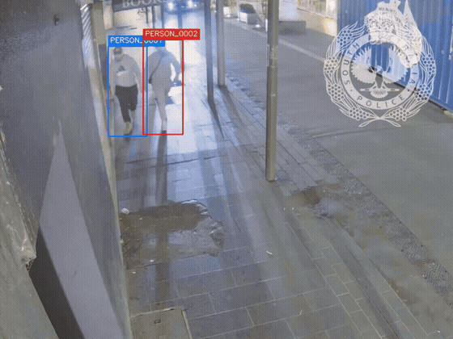
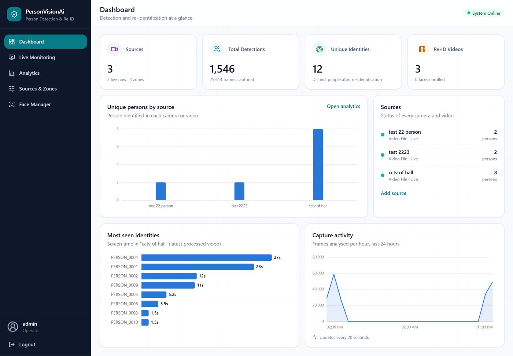
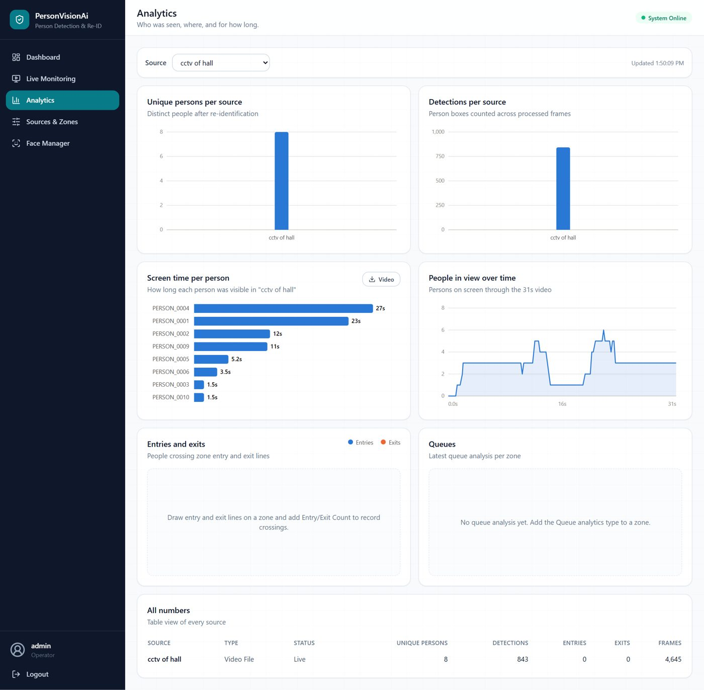
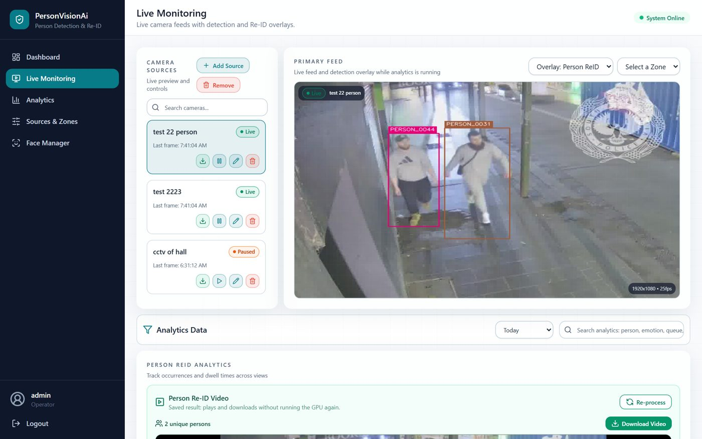
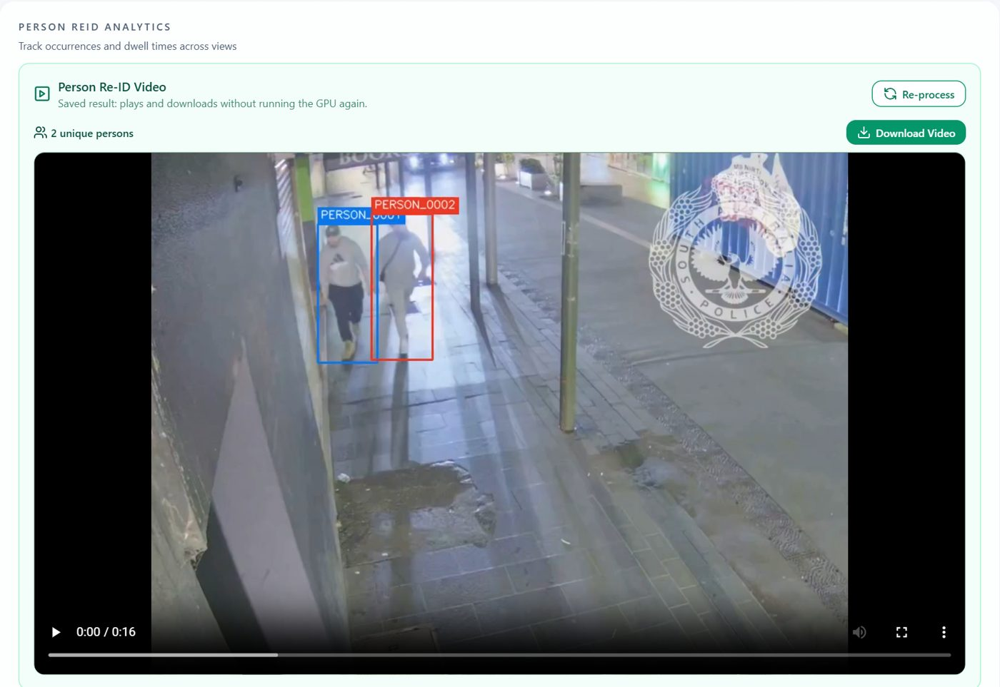
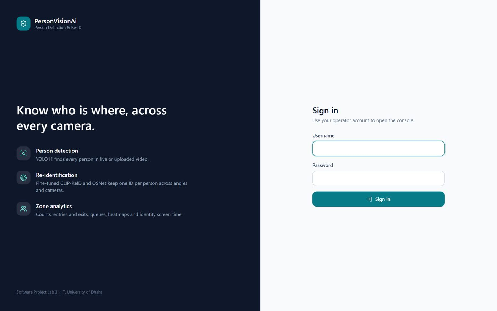
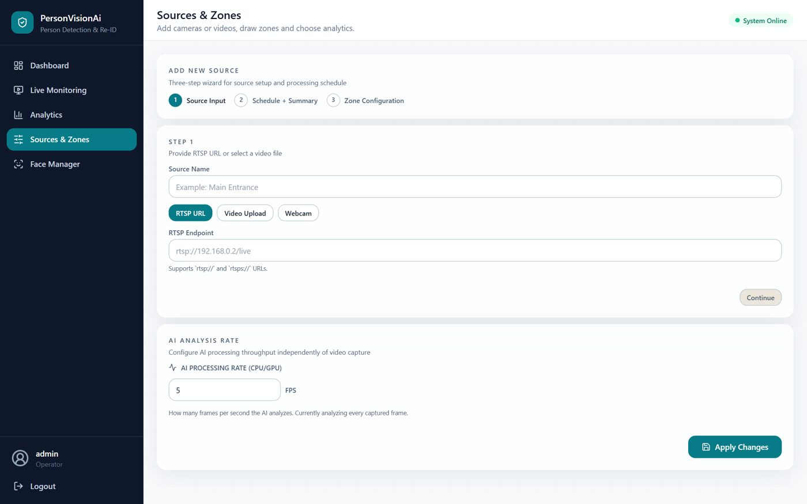
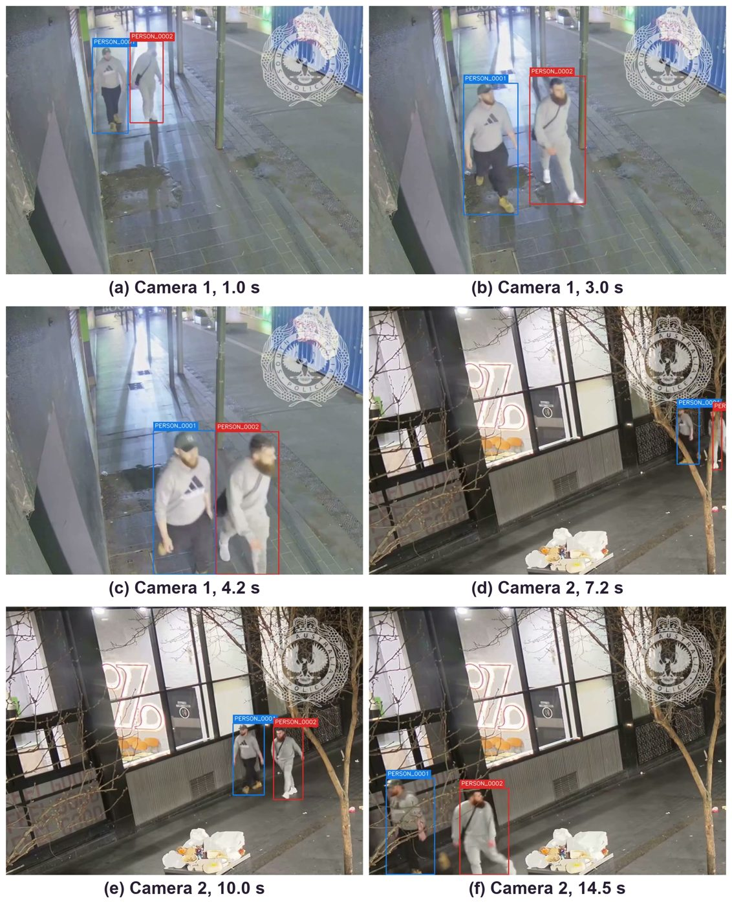

<div align="center">

# PersonVisionAi

**Person detection, tracking and re-identification for CCTV, with a web console that shows who was where, and for how long.**

Next.js 14 · FastAPI · YOLO11 · ByteTrack · CLIP-ReID · OSNet-AIN · CUDA



*Two people keep PERSON_0001 and PERSON_0002 when the footage cuts to a second camera with a different angle and light ([MP4](docs/media/demo_reid.mp4)).*

<br><br>

<video src="cctv_of_hall_ReID.mp4" width="560" controls></video>

*Hall corridor CCTV Re-ID evaluation video ([MP4](cctv_of_hall_ReID.mp4)).*

</div>

---

## Contents

- [Features](#features)
- [Screenshots](#screenshots)
- [How it works](#how-it-works)
- [Models and datasets](#models-and-datasets)
- [Accuracy](#accuracy)
- [Run on localhost](#run-on-localhost)
- [Run on a cloud GPU (vast.ai)](#run-on-a-cloud-gpu-vastai)
- [Configuration](#configuration)
- [Project structure](#project-structure)

## Features

- **Sources:** RTSP cameras, uploaded video files and a webcam.
- **Zones:** draw polygons, rectangles and entry/exit lines on the first frame of each source.
- **Live monitoring:** an MJPEG feed with a box and a persistent `PERSON_xxxx` label for every person.
- **Re-identification:** each person keeps one ID across angles, short occlusions and different cameras. Two people visible at the same time never share an ID.
- **Saved Re-ID video:** an uploaded video is processed once on the GPU and saved. The green ⬇ button on its source card downloads it; later downloads do not run the models again.
- **Analytics:** persons per camera, screen time per person, people in view over time, entries and exits, and queues.
- **More analytics:** face recognition (ArcFace), facial expression, trajectory heatmap and queue wait time.
- **Access control:** a login page with an HMAC-signed session cookie. Every page and API call requires a session.
- **Deployment:** the server updates itself from GitHub `main` every minute.

## Screenshots

| Dashboard | Analytics |
|---|---|
|  |  |
| **Live Monitoring** | **Saved Re-ID video** |
|  |  |
| **Sign in** | **Sources & Zones** |
|  |  |

<details>
<summary>Re-identification across two cameras (6 frames)</summary>



</details>

## How it works

```
frame ─► YOLO11x (persons) ─► ByteTrack (local tracks) ─► drop crops >15% covered by another person
      ─► 3 Re-ID models, fused (FP16) ─► average of ≥5 clean crops per track
      ─► match the gallery (cosine ≥ 0.58, one ID per person per camera) ─► assign or merge ID
      ─► draw box + PERSON_xxxx (box held 1.5 s through missed detections)
```

- **Provisional IDs.** A new track first gets a provisional ID. Its averaged embedding is compared with the gallery of known people, and the track takes over an existing ID when the score is at least 0.58.
- **The gallery.** Each person in the gallery keeps a mean embedding and up to 10 exemplars taken from different angles. A person is forgotten 30 minutes after last being seen.
- **Saved videos.** A saved Re-ID video is made in two passes. The first pass tracks the whole video; the second draws it with every provisional ID already replaced by the final one.

## Models and datasets

No model was trained in this project. Every model is used as published, with its pretrained or fine-tuned weights converted to FP16. The FP16 embeddings are identical to FP32 (cosine similarity 1.000000).

| Task | Model | Trained on |
|---|---|---|
| Person detection | YOLO11x (Ultralytics) | COCO (person class) |
| Tracking | ByteTrack (BoxMOT) | no learned weights |
| Re-ID 1 | CLIP-ReID, ViT-B/16 | MSMT17 |
| Re-ID 2 | CLIP-ReID, ViT-B/16 | Market-1501 |
| Re-ID 3 | OSNet-AIN x1.0 | MSMT17 |
| Offline analysis job | PersonViT (ViT-Base) | LUPerson (self-supervised) |
| Face recognition | ArcFace (DeepFace) | MS-Celeb-1M |

**About the datasets:**
- **Market-1501:** 32,668 images of 1,501 people from 6 cameras ([Project Page & Downloads](https://zheng-lab.cecs.anu.edu.au/Project/project_reid.html) · [Google Drive Download](https://drive.google.com/file/d/0B8-rDuOCHvdTRGh0dU3Vlo1dVU/view) · [Kaggle Mirror](https://www.kaggle.com/datasets/pengkai/market1501) · [Paper](https://www.cv-foundation.org/openaccess/content_iccv_2015/papers/Zheng_Scalable_Person_Re-Identification_ICCV_2015_paper.pdf)).
- **MSMT17:** 126,441 images of 4,101 people from 15 cameras ([Project Page](https://www.pkuvmc.cc/publications/msmt17.html) · [Paper](https://arxiv.org/abs/1711.08565)).
- **LUPerson:** Large-scale person Re-ID dataset ([GitHub](https://github.com/D-X-Y/LUPerson) · [Paper](https://arxiv.org/abs/2103.14468)).
- **Evaluation data:** the project's own test videos, two of them hand-labelled: a street clip with two cameras, and a hall corridor recorded on campus. They are not published because they show people's faces.

> **Note:** The actual dataset files and directories (e.g. `Market-1501/`) are intentionally excluded from this git repository to avoid repository bloat. Download them from the links above if you need them for offline evaluation.


## Accuracy

Measured on the deployed GPU server, across detection, tracking and identity together, against hand-labelled ground truth. Method and scripts are in [`evaluation/`](evaluation/README.md).

| Metric | Result |
|---|---|
| Detection recall | **96.4%** |
| Detection precision | **90.0%** |
| MOTA | **85.1%** |
| IDF1 | **82.2%** (93.5% on the corridor video after the occlusion fix) |
| Re-ID true-accept rate at 1% false matches | 64.3% (old setup) → **99.2%** |

The numbers come from two short videos (48 s in all). Most false positives are boxes held for 1.5 s after a person leaves the frame.

## Run on localhost

**Requirements:**
- Python 3.11
- Node.js 18 or newer
- FFmpeg on the `PATH`
- An NVIDIA GPU is strongly recommended. The app also runs on a CPU, but only at about one analysed frame per second.

### 1. Backend

```bash
git clone https://github.com/Shakibbhai/Vision-Lab.git
cd Vision-Lab
python -m venv .venv
# Windows: .venv\Scripts\activate    Linux/macOS: source .venv/bin/activate
pip install -r requirements.txt
cp .env.example .env              # then edit it, see Configuration
```

Put the model weights in `data/models/`:

```
data/models/yolo11x.pt
data/models/reid/clip_msmt17.pt
data/models/reid/clip_market1501.pt
data/models/reid/osnet_ain_x1_0_msmt17.pt
```

Where to get them:
- **YOLO11x:** downloaded by Ultralytics on first use.
- **CLIP-ReID:** from the official [CLIP-ReID repository](https://github.com/Syliz517/CLIP-ReID).
- **OSNet-AIN:** from the [torchreid model zoo](https://kaiyangzhou.github.io/deep-person-reid/MODEL_ZOO).

Start the backend:

```bash
python run_backend.py             # http://127.0.0.1:8000
```

### 2. Frontend

```bash
cd frontend
npm install
# Windows PowerShell: $env:NEXT_PUBLIC_API_BASE="http://127.0.0.1:8000"; npm run dev
NEXT_PUBLIC_API_BASE=http://127.0.0.1:8000 npm run dev
```

Open **http://localhost:3000** and sign in with **admin / admin123**. To set your own login, create `frontend/.env.local`:

```
AUTH_USERNAME=admin
AUTH_PASSWORD=your-password
AUTH_SECRET=a-long-random-string
```

### 3. Use it

1. **Sources & Zones** → **Add Source**: give it a name, choose **Video Upload**, and save.
2. Draw a zone over the floor, add **Person ReID**, and press **Save & Start Processing**.
3. **Live Monitoring**: choose **Overlay: Person ReID** to see the live IDs.
4. Press the green **⬇** on the source card to process the video once and download the Re-ID video.
5. **Analytics** now shows persons, screen time and the timeline for that source.

## Run on a cloud GPU (vast.ai)

The production setup runs on a vast.ai instance with an RTX 3090:
- Supervisor keeps the backend (`127.0.0.1:8000`) and the frontend (`127.0.0.1:13000`) running.
- Caddy publishes the frontend on port **10100**, behind the instance token.
- A cron job deploys every new commit on `main`.

### 1. Create the instance

1. On vast.ai, rent a GPU (an RTX 3090 or better works well) with the **PyTorch (Vast)** template. Add your SSH public key, and open port 10100.
2. Connect with the SSH command from the instance card, for example:

   ```bash
   ssh -p <PORT> root@<IP>
   ```

### 2. Install

```bash
cd /workspace
git clone https://github.com/Shakibbhai/Vision-Lab.git
cd Vision-Lab
source /venv/main/bin/activate
pip install -r requirements.txt
cp .env.example .env              # set the model paths and the Re-ID settings below
. /opt/nvm/nvm.sh && cd frontend && npm ci && NEXT_PUBLIC_API_BASE=http://127.0.0.1:8000 npm run build && cd ..
bash deploy/vast/install.sh       # Supervisor services, Caddy entry, autodeploy cron, login file
```

Some hosts cannot reach Google Drive or Hugging Face. On those hosts, download the model weights on your PC and upload them:

```bash
scp -P <PORT> -r data/models root@<IP>:/workspace/Vision-Lab/data/
```

### 3. Open and sign in

- **Open the app:** use the instance's **Open** button, or `http://<IP>:<external port of 10100>/?token=<instance token>`.
- **Login:** `install.sh` creates a random password once. Read it with:

   ```bash
   cat /workspace/Vision-Lab/frontend/.env.local
   ```

   To use your own password, change `AUTH_PASSWORD` in that file, then run `supervisorctl restart visionlab-frontend`.
- **Updates:** push to `main`. Within a minute the server pulls the change and restarts only the part that changed. The log is in `/var/log/portal/visionlab-autodeploy.log`.

**Useful commands:**

```bash
supervisorctl status                               # both services should be RUNNING
supervisorctl restart visionlab-backend
nvidia-smi                                         # the backend should hold ~3.5 GB of GPU memory
df -h /                                            # frames are kept 7 days; keep an eye on disk space
```

## Configuration

The backend reads `.env` from the repository root. The settings that matter most:

| Variable | Recommended | Meaning |
|---|---|---|
| `YOLO_MODEL_PATH` | `./data/models/yolo11x.pt` | Person detector |
| `YOLO_CONFIDENCE` | `0.3` | Detection threshold |
| `REID_OVERLAY_WEIGHTS` | `./data/models/reid/clip_msmt17.pt,./data/models/reid/clip_market1501.pt,./data/models/reid/osnet_ain_x1_0_msmt17.pt` | Re-ID models, fused |
| `REID_OVERLAY_USE_PERSONVIT` | `false` | Leave PersonViT out of the live Re-ID |
| `REID_MATCH_THRESHOLD` | `0.58` | Cosine score needed to reuse an ID |
| `MIN_CAPTURE_INTERVAL_SECONDS` | `0.2` on a GPU, `1.0` on a CPU | Fastest capture rate |
| `BOXMOT_DEVICE` | `cuda:0` (or `cpu`) | Device for tracking and Re-ID |
| `DATABASE_URL` | `sqlite+aiosqlite:///./data/app.db` | Database |

## Project structure

```
PERCEPTA-ReIdentification-System
│
├── ai_service/
│   ├── reid_pipeline.py
│   ├── faiss_tracker.py
│   ├── gallery_manager.py
│   ├── model_loader.py
│   └── utils.py
│
├── backend/
│   ├── main.py
│   ├── config.py
│   ├── generate_tsne.py
│   └── requirements.txt
│
├── frontend/
│   ├── public/
│   └── src/
│
├── docs/
│
└── README.md
```

---

<div align="center">
Software Project Lab 3 · Institute of Information Technology, University of Dhaka
</div>
